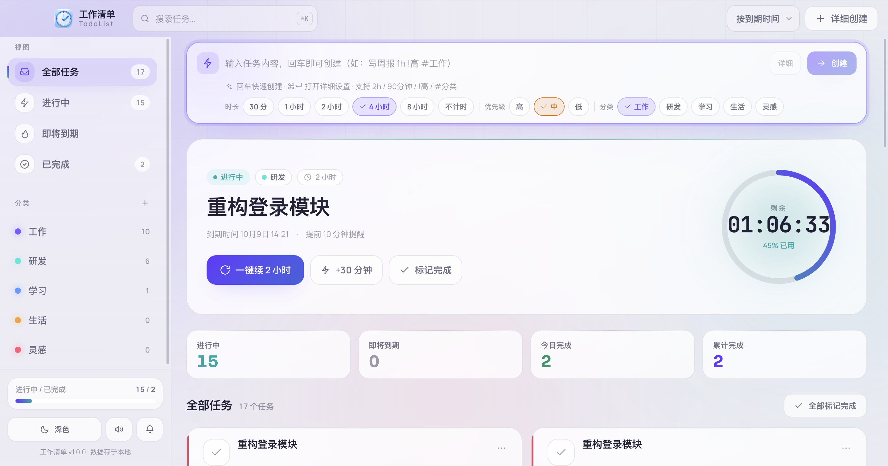
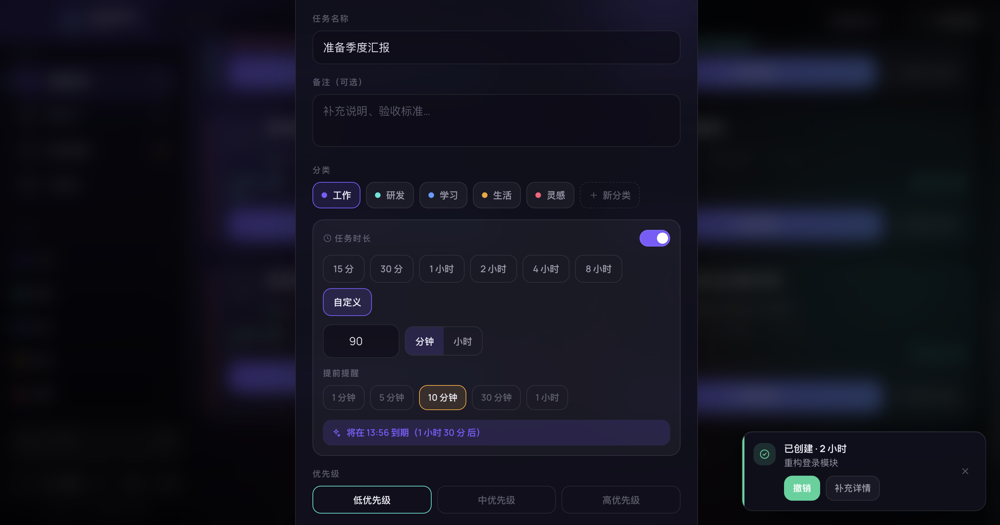
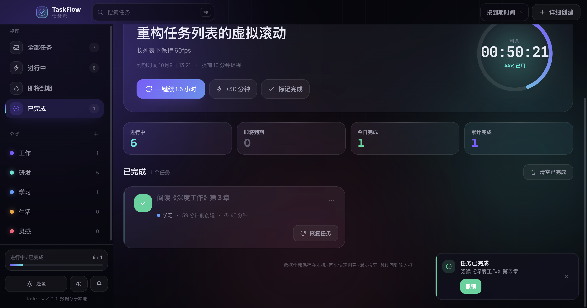
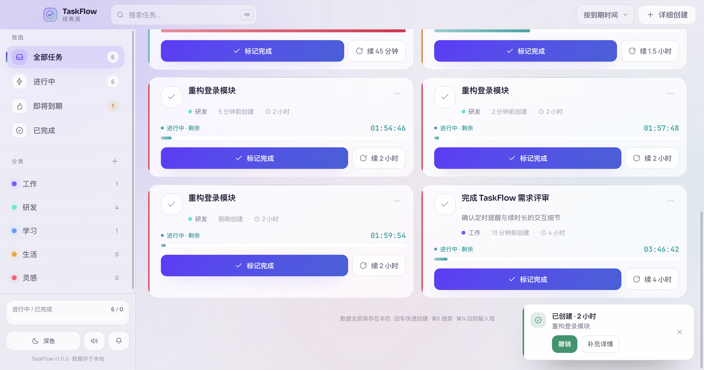

# Sloth · TaskFlow

> 优雅的桌面任务管理清单 + 离线「工作速录」。
> 定时到期提醒、一键续时长、每周任务与未来计划、工作清单表格、打卡、轻笔记，以及一套完全本地运行的录音 / 实时字幕 / 转写 / 降噪工具链。

Electron 33 + React 18 + TypeScript + Vite 5 + Tailwind CSS 3，macOS（arm64，DMG）与 Windows（NSIS 安装包）双端打包。



---

## 目录

- [功能总览](#功能总览)
- [工作速录](#工作速录)
- [技术栈](#技术栈)
- [目录结构](#目录结构)
- [环境要求](#环境要求)
- [快速开始](#快速开始)
- [下载离线模型（必读）](#下载离线模型必读)
- [构建与打包](#构建与打包)
- [数据存储与备份](#数据存储与备份)
- [常见问题](#常见问题)
- [License](#license)

---

## 功能总览

### 任务

- **自然输入快速创建**：在输入框直接写 `写周报 1h !高 #工作`，自动解析出时长、优先级与分类；`Enter` 创建，`⌘N` / `Ctrl+N` 聚焦输入框。
- **定时到期提醒**：任务按「开始 + 时长」计算到期时刻，默认提前 10 分钟系统通知 + 提示音，Dock / 任务栏显示待办数量角标。
- **一键续时长**：到期未完成时按原时长续期，或直接「续 30 分钟 / 续 1 小时」，并记录续期次数。
- **子任务拆分**：新建/编辑时可拆分子任务，父任务进度随子任务完成情况推进。
- **完成动效**：完成任务时从点击位置撒出粒子庆祝（纯 CSS，无第三方依赖）。
- **回收站**：删除任务先进回收站，可恢复或彻底删除。
- **分类**：自定义分类、颜色、重命名与删除，侧栏按分类过滤。

### 视图

| 视图 | 说明 |
| --- | --- |
| 全部任务 / 进行中 / 即将到期 / 已完成 | 主清单，支持按紧急度、创建时间、标题、优先级排序，支持搜索（`⌘K`） |
| 每周任务 | 以周围单位组织任务，含每周完成数 / 时长的统计弹窗 |
| 未来计划 | 月历视图，任意日期**右键**即可连续添加计划；过去日期只读；单元格显示农历 |
| 专注模式 | 全屏专注计时，25 / 45 / 60 分钟预设，可暂停、提前完成，结束提示音 |
| 轻量模式 | 主窗口收起，待办以「飘条」形式从屏幕顶部依次飘过（约每 3 分钟一轮），鼠标悬停暂停、点击唤回主窗口；菜单栏额外出现托盘图标 |

### 工作清单（表格）

内置轻量电子表格：多工作表、单元格编辑、**公式求值**、全屏编辑（`Esc` 退出）、
Excel / CSV 导入导出（基于 `xlsx`）、带样式的富文本复制粘贴。

### 打卡与笔记

- **打卡**：习惯列表，每天一键打卡，显示连续天数、周视图与月历视图。
- **轻笔记**：Markdown 笔记，支持粘贴图片、置顶；独立的**悬浮速记**窗口随时记录。

### 其他

- 深色 / 浅色主题切换（跟随系统或手动）。
- 提示音、系统通知开关。
- 侧栏可直接「显示数据文件」（打开 `taskflow-data.json` 所在目录）。

<p>
  
  
</p>
<p>
  
  
</p>

---

## 工作速录

侧栏「工作速录」是一个内嵌的录音工作站，分 **速录 / 资料库 / 编辑器** 三个页签，全部离线运行。

### 速录

- 麦克风录制，也可捕获**系统内录**（会议、视频声音）；支持多轨同时采集。
- 电平表 + 实时波形，录音时自动阻止系统休眠。
- **实时转写**：边录边出中文字幕（流式 Zipformer2，模型见下文），可开启**字幕悬浮窗**——透明置顶小窗，看视频时当字幕用，可设鼠标穿透。
- 悬浮录音球：不占主窗口也能随时开始/停止。

### 资料库

- 录音列表，支持按名称**或转写内容**搜索。
- 录音结束后把整段音频交给后台队列**离线转写**（可排队、显示进度、取消、失败重试）。
- 转写文本可展开查看、复制。

### 编辑器

- 波形编辑：裁剪、分割、增益、淡入淡出、**修复爆音**（咔哒声插值修复）等非破坏性操作——原始录音永不被修改，只在导出时生成新文件。
- **离线降噪**（GTCRN），可随时「还原原声」。
- 导出 **WAV / MP3**，可选 **EBU R128 响度标准化**（podcast −16 LUFS / 流媒体 −14 LUFS），依赖内置 ffmpeg。

### 模型与隐私

三类模型（VAD、ASR、降噪）全部本地推理，**音频与文本不出本机**。
模型文件体积较大，不随仓库分发，见 [下载离线模型](#下载离线模型必读)。

---

## 技术栈

| 层 | 选型 |
| --- | --- |
| 桌面框架 | Electron 33 |
| 渲染层 | React 18 + TypeScript 5 + Vite 5 + Tailwind CSS 3 |
| 状态管理 | Zustand |
| 打包 | electron-builder 25（`electron-builder.yml` / `electron-builder-win.yml`） |
| 语音识别 | sherpa-onnx-node（流式 Zipformer2 中文 int8 + Silero VAD） |
| 音频处理 | Web Audio / AudioWorklet + ffmpeg-static +`offline-speech-denoiser`（GTCRN） |
| 其他 | xlsx、wavesurfer.js、lunar-typescript |

渲染层构建目标为 `chrome128`，主进程为 CommonJS（`.cjs`）。

---

## 目录结构

```
taskflow/
├─ desc.txt                  # 简版技术栈备忘
├─ package.json              # 项目元信息副本（真正参与构建的是 source/package.json）
├─ screenshots/              # 界面截图
└─ source/                   # ← 实际工程根目录
   ├─ electron/              # 主进程
   │  ├─ main.cjs            # 窗口、托盘、通知、轻量模式、数据读写、文件对话框
   │  ├─ preload.cjs         # 暴露给渲染层的安全 API
   │  ├─ recorder/           # 工作速录主进程：录制、ASR、降噪、资料库、导出
   │  └─ workers/            # ASR / 整段转写 / 降噪 utilityProcess 入口
   ├─ src/                   # 渲染层
   │  ├─ components/         # 任务、计划、每周、打卡、笔记、表格、专注模式…
   │  ├─ store/              # 应用状态与持久化
   │  ├─ recorder/           # 工作速录：录音、资料库、编辑器、字幕窗
   │  ├─ lib/                # 时间/农历、快捷解析、剪贴板、Markdown、音效…
   │  └─ fonts/              # Manrope / Sora / JetBrains Mono
   ├─ resources/models/      # 离线模型（大文件不入库，见下）
   ├─ build/                 # 应用图标（electron-builder buildResources）
   ├─ dist/                  # Vite 产物（不入库）
   ├─ release/               # 打包产物（不入库）
   ├─ electron-builder.yml     # macOS dmg
   └─ electron-builder-win.yml # Windows NSIS
```

---

## 环境要求

- Node.js **18+**（开发时使用 v24 验证通过），npm 9+
- macOS 12+（打包 dmg 需要 Apple Silicon）
- Windows 10/11 x64（打包安装包）
- 打包体积约 300 MB+，其中模型占 155 MB

---

## 快速开始

```bash
cd source
npm install          # 安装依赖（含 Electron、sherpa-onnx 原生模块）
npm run dev          # 同时启动 Vite(5173) 与 Electron，热更新
```

`npm run dev` 由 `concurrently` 拉起两个进程：

- `dev:renderer` → `vite`（端口 5173，`strictPort`，被占用会直接失败）
- `dev:electron` → `wait-on tcp:5173` 后启动 `electron .`

其他脚本：

```bash
npm run build              # tsc --noEmit 类型检查 + vite build → dist/
npm run smoke:lightmode    # 轻量模式冒烟测试（electron 直跑脚本）
npm run smoke:topbar       # 顶栏快捷操作冒烟测试
npm run smoke:packed       # 打包后产物冒烟测试
```

> 首次启动前建议先按下一节下载模型，否则「实时转写 / 降噪」会提示缺少模型（其余功能不受影响）。

---

## 下载离线模型（必读）

模型目录：`source/resources/models/`。开发时从仓库读取，打包后由 `extraResources` 复制到 `resources/models`。

### 需要的文件

| 文件 | 大小 | 用途 | 是否入库 |
| --- | --- | --- | --- |
| `models/silero_vad.onnx` | ~0.6 MB | 语音活动检测（VAD 分段） | ✅ 已提交 |
| `models/gtcrn_simple.onnx` | ~0.5 MB | 离线降噪 | ✅ 已提交 |
| `models/zipformer-zh/encoder.int8.onnx` | **~154 MB** | 中文流式 ASR 主模型 | ❌ 超过 GitHub 100 MB 限制 |
| `models/zipformer-zh/decoder.onnx` | ~4.9 MB | ASR 解码器 | ❌ 同上（整目录忽略） |
| `models/zipformer-zh/joiner.int8.onnx` | ~1 MB | ASR joiner | ❌ |
| `models/zipformer-zh/tokens.txt` | ~24 KB | 词表 | ❌ |

模型为 `sherpa-onnx-streaming-zipformer-zh-int8-2025-06-30`，**架构是 zipformer2**。
（若换成旧版 zipformer 模型，`electron/workers/*.cjs` 里的 `modelType: 'zipformer2'` 需要改，否则会在 `InitEncoder` 取 `attention_dims` 时崩溃。）

### 一键下载（国内推荐 hf-mirror）

```bash
cd source
# 1) 流式中文 ASR（154 MB，最大的一个）
base=https://hf-mirror.com/csukuangfj/sherpa-onnx-streaming-zipformer-zh-int8-2025-06-30/resolve/main
mkdir -p resources/models/zipformer-zh
for f in encoder.int8.onnx decoder.onnx joiner.int8.onnx tokens.txt; do
  curl -L --retry 3 -o "resources/models/zipformer-zh/$f" "$base/$f"
done
```

```bash
# 2) VAD（GitHub 直连；网络不通时可用代理或多试几次）
curl -L --retry 3 -o resources/models/silero_vad.onnx \
  https://github.com/k2-fsa/sherpa-onnx/releases/download/asr-models/silero_vad.onnx

# 3) 降噪 GTCRN
curl -L --retry 3 -o resources/models/gtcrn_simple.onnx \
  https://github.com/k2-fsa/sherpa-onnx/releases/download/speech-enhancement-models/gtcrn_simple.onnx
```

海外网络可把 `hf-mirror.com` 换成 `huggingface.co`。

### 校验

```bash
cd source/resources/models
du -h silero_vad.onnx gtcrn_simple.onnx zipformer-zh/*
```

应大致为：`632K`、`524K`、`154M`、`4.9M`、`1.0M`、`24K`。
若下载中断会得到几十 KB 的 HTML/空文件，请删掉重下。

### 缺模型时的表现

程序会对每个模型单独探测（`electron/recorder/asr-models.cjs`、`denoise-models.cjs`）：

- 缺 ASR / VAD → 「实时转写」开关置灰，提示 `缺少模型文件：encoder.int8.onnx…`；整段转写任务报同样的错误。
- 缺 GTCRN → 编辑器里「离线降噪」不可用，其余编辑、导出正常。
- 任务管理、表格、打卡、笔记等所有非录音功能完全不受影响。

### 模型放在别处

运行时路径规则（`electron/recorder/resources.cjs`）：

- 开发模式：`app.getAppPath()/resources/models`
- 打包后：`process.resourcesPath/models`（即 `Sloth.app/Contents/Resources/models`）

所以只要保持目录名与文件名不变，替换整个 `zipformer-zh/` 目录即可升级模型，无需改代码。

---

## 构建与打包

### macOS（dmg，arm64）

```bash
cd source
npm run dist
# = tsc --noEmit && vite build && electron-builder --mac dmg
```

产物：`source/release/Sloth-v20261022.1-arm64.dmg`

分步执行（调试更快）：

```bash
npm run build                                  # 只构建渲染层
npx electron-builder --mac dir --arm64         # 只出 .app，约 3 秒
npx electron-builder --mac dmg --arm64         # 出 dmg
```

仓库里的 `scripts/make-dmg.sh` 是作者自用的一键脚本（构建 → `--mac dir` → 校验 `app.asar` 完整性 → `hdiutil` 生成 DMG → 挂载自检 → 复制到指定目录）。
其中的 `APP_NAME`、`DEST` 是硬编码的，复用前请按自己的项目改名。

### Windows（NSIS 安装包，x64）

**在 Windows 上执行**（原生模块与 Electron 二进制必须是对应平台）：

```bat
cd source
npm ci
npx electron-builder --config electron-builder-win.yml --win nsis --x64
```

产物：`source/release/Sloth-Setup-<version>-x64.exe`

- Windows 配置单独放在 `electron-builder-win.yml`：**不能**复用 `electronDist`（那是 macOS 的 Electron），会走镜像下载 win32-x64 发行版。
- 打包前若下载 Electron 很慢，可设镜像：

  ```bash
  # macOS / Linux
  export ELECTRON_MIRROR=https://npmmirror.com/mirrors/electron/
  # Windows CMD
  set ELECTRON_MIRROR=https://npmmirror.com/mirrors/electron/
  ```

### 打包配置要点

`electron-builder.yml`（mac）与 `electron-builder-win.yml`（win）共享同一套策略：

| 配置 | 作用 |
| --- | --- |
| `files: dist/**, electron/**, package.json` | 只打必要文件，源码、脚本、`resources` 原始目录不进 asar |
| `asar: true` | 代码打进 `app.asar` |
| `asarUnpack: ffmpeg-static, sherpa-onnx-*, electron/workers` | 原生 `.node` 与 `utilityProcess.fork` 的 worker 必须解包到 `app.asar.unpacked`，asar 内无法 spawn/加载 |
| `extraResources: resources/models → models` | 模型随包分发，运行时从 `process.resourcesPath/models` 读取 |
| `npmRebuild: false` | 依赖自带预编译产物，不重编 |
| `electronDist: node_modules/electron/dist`（仅 mac） | 复用已安装的 Electron，避免重复下载 |
| `identity: null` / `hardenedRuntime: false` | **不签名、不公证** |

macOS 相关的权限描述（麦克风、系统音频捕获）写在 `mac.extendInfo` 里，缺失会导致录音拿不到权限。

### 版本号与产物名

- 版本号在 `source/package.json` 的 `version`（当前 `2026.10.22-1`）。
- ⚠️ `electron-builder.yml` 里 `dmg.title` 与 `dmg.artifactName` **写死了** `v20261022.1`。发新版本时要同步修改这三处，否则 dmg 名字和窗口标题会对不上。
- Windows 用 `${version}` 变量，不需要手改。

### 未签名说明

产物没有代码签名：

- macOS 首次打开会提示「无法验证开发者」→ 右键 →「打开」，或执行
  `xattr -dr com.apple.quarantine /Applications/Sloth.app`
- Windows 会出现 SmartScreen 提示 → 「更多信息」→「仍要运行」

---

## 数据存储与备份

所有数据存在单个 JSON 文件里（`electron/main.cjs` 的 `dataFile()`）：

- macOS：`~/Library/Application Support/Sloth/taskflow-data.json`
- Windows：`%APPDATA%\Sloth\taskflow-data.json`

侧栏底部「显示数据文件」可直接在 Finder / 资源管理器中定位。备份就是复制这个文件。

工作速录的音频与工程文件存放在应用数据目录下的独立子目录（资料库里右键可「在文件夹中显示」）。

---

## 常见问题

**Q：克隆下来为什么没有 `node_modules`、`release` 和 154 MB 的模型？**
A：都在 `.gitignore` 里。`node_modules` 用 `npm install` 装，`release` 是打包产物，模型按 [下载离线模型](#下载离线模型必读) 获取。

**Q：`npm run dist` 报错找不到模型 / 打出来的包没有转写？**
A：打包不会校验模型，缺了照样出包，只是运行时转写不可用。出包前确认 `source/resources/models/zipformer-zh/` 四个文件齐全。

**Q：`npm run dev` 报端口占用？**
A：Vite 配置了 `strictPort: true`，5173 被占用会直接失败，先释放端口。

**Q：macOS 打包后应用一打开就闪退？**
A：不要用 `asar pack dist app.asar` 做「热更新」——那会把 `package.json` 和 `electron/main.cjs` 一起替换掉，主进程找不到入口。请用 `electron-builder --mac dir` 全量重打（约 3 秒）。
另外在受限终端里运行时 Chromium 沙箱可能被禁用，可加 `--no-sandbox` 临时验证。

**Q：Windows 打包失败 / 原生模块报错？**
A：必须在 Windows 上 `npm ci` 后再打包；在 macOS 上交叉打 Windows 包会带上 darwin 的 `sherpa-onnx` 原生库。

**Q：录音没有声音 / 无法内录？**
A：首次使用需授予麦克风（macOS 还要在「系统设置 → 隐私与安全性 → 屏幕录制 / 音频录制」中授权）；系统内录依赖 macOS 的音频捕获能力。

**Q：想用 Git LFS 把模型也放进仓库？**
A：可以，但 154 MB 单文件会消耗 LFS 免费额度（1 GB 存储/月），克隆也慢。默认方案是「按需下载」，推荐保持现状。

---

## License

MIT © 2026 Chen Weiyong
